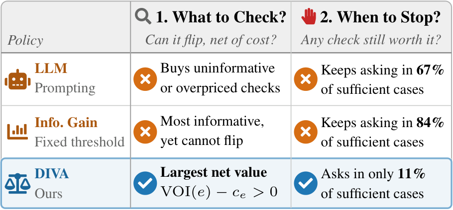
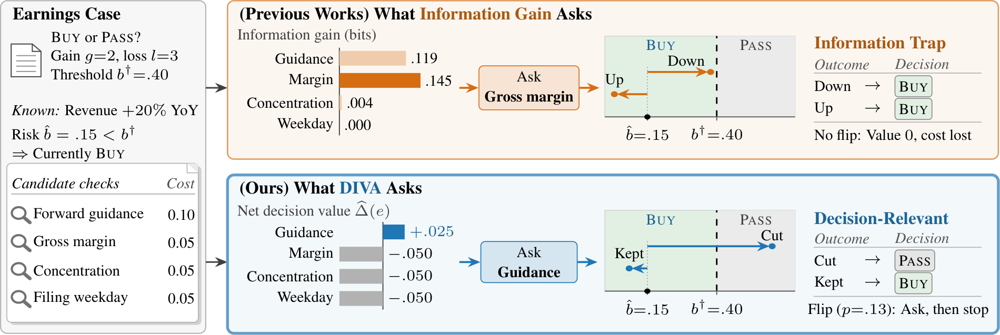
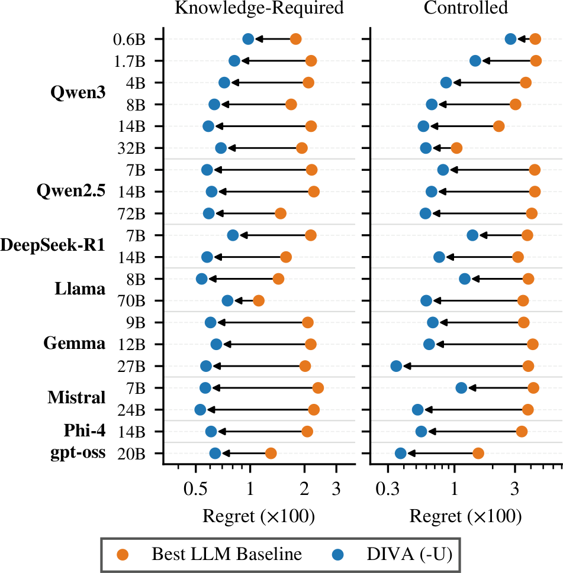

<div align="center">

# Not All Information Is Worth Asking For:<br>Decision-Informed Information Seeking with LLMs

**DIVA: Decision-Informed Value-of-information Acquisition**

[](https://arxiv.org/abs/2610.32181)
[](https://arxiv.org/pdf/2610.32181)
[](https://github.com/seunghan96/diva)

Seunghan Lee, Jun Seo, Junhyeok Kang, Jaehoon Lee, Sangjun Han, Sungdong Yoo,<br>
Minjae Kim, Tae Yoon Lim, Dongwan Kang, Hwanil Choi, Soonyoung Lee, Wonbin Ahn

LG AI Research

</div>

Official code for the paper
[*Not All Information Is Worth Asking For: Decision-Informed Information Seeking with LLMs*](https://arxiv.org/abs/2610.32181).

---

## The information trap

LLMs are increasingly used to support decisions under incomplete information,
where deciding **what to look up** and **when to stop** matters as much as the
final answer. They fall into an *information trap*: they pay for checks, i.e.,
costly pieces of evidence, that cannot change their decision or are not worth
their cost, and they keep asking when the evidence is already sufficient.

<div align="center">


*A good decision maker acquires only checks that can change its decision net of their cost, and stops once no check is worth its cost.*
</div>

## The method

DIVA is training-free and applies to any LLM.

1. The LLM **specifies a small decision model** through short numeric
   questions, i.e., how likely a bad outcome is and how each check would shift
   that probability.
2. Each candidate check is **valued by how much its imagined outcomes improve
   the decision, net of its cost**. DIVA acquires the best check and stops
   when no check is worth its cost.

<div align="center">


*Information gain asks for the gross margin, whose outcomes cannot move the belief across the decision threshold. DIVA asks for the forward guidance, whose cut would flip the decision, and then stops.*
</div>

Two variants share the same decision model.

| Variant | What it adds |
|---|---|
| **DIVA-U** | averages the decision value over plausible strengths of each check, since the LLM's estimates are uncertain |
| **DIVA-DP** | plans every remaining acquisition with exact dynamic programming instead of valuing only the next one |

## Results

Across **12 decision environments in four domains and 20 LLMs**, DIVA-U has
lower regret than every LLM baseline on real-world data, mainly by stopping
once evidence suffices, and DIVA cuts the regret of the best LLM baseline by
**75%** in controlled scenarios where every check's reliability is given.

<div align="center">


*Regret of the best LLM baseline of each LLM (orange) and DIVA (blue, DIVA-U on knowledge-required environments).*
</div>

## Structure
```
envs_synth/   controlled environments (stated reliabilities, exact DP optimum)
envs_tab/     knowledge-required environments on UCI records
envs_real/    knowledge-required environments on SEC filings
scripts/      DIVA (elicitation, decision value, stopping), evaluation, and aggregation
baselines/    LLM baselines (Direct, CoT, SC, ReAct, Ask-P, VoI-P, VoI-Ask, BED-LLM, PAL, ...)
serving/      vLLM serving script and client
```

## Setup
```
pip install vllm numpy pandas scipy scikit-learn lightgbm pyarrow matplotlib
bash serving/serve_one.sh   # serve an open-weight LLM (checkpoints in the "Models and Hardware" appendix)
```
Set the served endpoints in `serving/client.py`.

## Running DIVA
```
# 1. Elicit the decision model (short numeric questions)
python scripts/run_factored.py      # controlled environments
python scripts/run_factored_k.py    # UCI records
python scripts/run_factored_real.py # SEC filings
# 2. Score DIVA, DIVA-U, DIVA-DP and the references
python scripts/eval_test.py         # controlled
python scripts/eval_tab.py          # UCI records
python scripts/eval_real.py         # SEC filings
python scripts/episodes_know.py     # full acquire-then-decide episodes
```

## Baselines
```
python baselines/run.py --model <served model> --methods all --env envs_synth/data/binary/finance_test.jsonl.gz
```

## Tables and figures
```
python scripts/agg_bin.py && python scripts/agg_know_main.py && python scripts/agg_episodes.py
python scripts/make_tables.py && python scripts/make_tables_app.py && python scripts/figs_all.py
```

## Data
UCI datasets are redistributed under their original licenses. SEC filings are public; `envs_real/scripts` rebuilds the records from SEC EDGAR.

## Citation

If you find this work useful, please cite the paper.

```bibtex
@article{lee2026diva,
  title   = {Not All Information Is Worth Asking For: Decision-Informed Information Seeking with LLMs},
  author  = {Lee, Seunghan and Seo, Jun and Kang, Junhyeok and Lee, Jaehoon and Han, Sangjun and Yoo, Sungdong and Kim, Minjae and Lim, Tae Yoon and Kang, Dongwan and Choi, Hwanil and Lee, Soonyoung and Ahn, Wonbin},
  journal = {arXiv preprint arXiv:2610.32181},
  year    = {2026}
}
```
